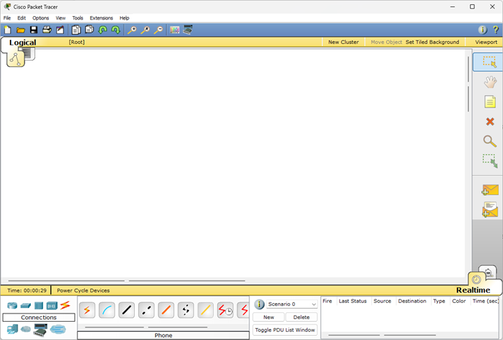
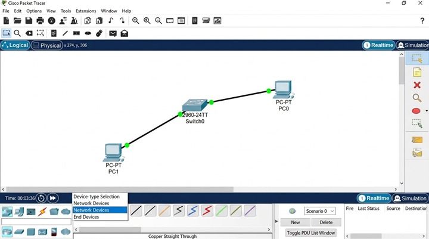
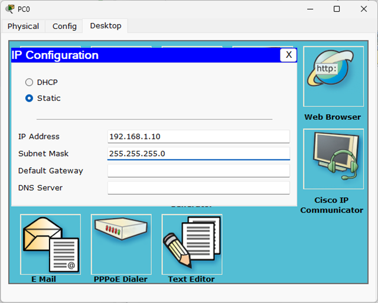
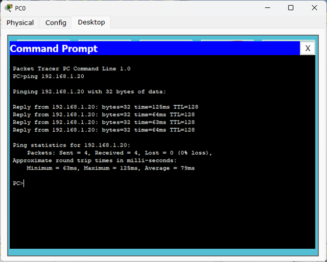
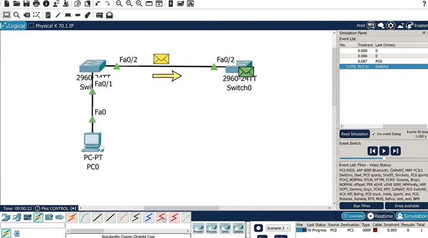

# UD3.A1. Simulador de xarxes i Ethernet

## Presentació de l'activitat

Què és Cisco Packet Tracer? Imagina que és com un "Minecraft" o un "SimCity" especialitzat en xarxes d'ordinadors. En lloc de construir ciutats o cases, aquí podràs muntar instal·lacions informàtiques senceres: des d'una petita xarxa domèstica fins a la infraestructura d'un gran edifici. El millor de tot és que és un entorn virtual totalment segur: pots connectar cables, configurar servidors i provar comandes sense por de trencar cap equip real ni deixar ningú sense connexió.

En aquesta primera sessió de laboratori faràs el teu primer "desplegament". Construiràs una xarxa local (LAN) bàsica formada per dos ordinadors connectats mitjançant un commutador (Switch). L'objectiu és que perdis la por al programari, aprenguis a moure't per la seva interfície, assignis les primeres adreces IP i comprovis que els equips es comuniquen correctament fent servir la comanda ping i el mode de simulació visual.

A continuació, veuràs les diferències de funcionament entre un hub (concentrador) i un switch (commutador), observant el fenòmen de les col·lisions i entenent perquè actualment, les xarxes Ethernet utilitzen commutadors en lloc de concentradors. Així mateix, observaràs el format de les trames Ethernet i com es transmeten a través del cablejat.

### Durada de l'activitat

La durada prevista de l'activitat és 4 hores a classe.

### Objectius específics de l'activitat

- Dissenyar i simular xarxes locals senzilles identificant els dispositius i el cablejat necessaris.
- Comprovar el funcionament de la xarxa simulada analitzant la connectivitat entre equips.

### Competències treballades

e) Instal·lar i configurar xarxes locals cablejades, sense fil o mixtes, i la seva connexió a xarxes públiques, assegurant-ne el funcionament en condicions de qualitat i seguretat.

g) Realitzar les proves funcionals en sistemes microinformàtics i xarxes locals, localitzant i diagnosticant disfuncions, per comprovar i ajustar el seu funcionament.

### Resultats d'aprenentatge i criteris d'avaluació

0225.RA2. Desplega el cablejat d'una xarxa local interpretant-ne especificacions i aplicant-hi tècniques de muntatge

- 2.1 Reconeix els principis funcionals de les xarxes locals.
- 2.2 Identifica els diferents tipus de xarxes.
- 2.3 Diferencia els mitjans de transmissió.

### Continguts

- Desplegament del cablejat.
- Interconnexió d'equips en xarxes locals

### Capacitats clau treballades

- Autonomia
- Organització del treball
- Resolució de problemes
- Responsabilitat

### Semàfor ús de la IA

🟠 Aquesta activitat permet un ús parcial o restringit.

Permès per com a eina de suport en la millora de la redacció dels informes, cerca preliminar d'informació, estructuració d'idees o explicació de conceptes teòrics complexos.

**Condicions**: Cal processar, entendre i validar sempre els resultats rebuts. Està totalment prohibit copiar l'enunciat d'un exercici directament al xat de la IA i enganxar la resposta generada per al lliurament final sense treball propi ni anàlisi crítica.

## Enunciat de l'activitat

### Requisits previs

Usarem la versió 5.3.3 de Cisco Packet Tracer. A la Comuna, trobaràs un arxiu comprimit. Fes una còpia de l'arxiu al teu ordinador i descomprimeix-lo. Dins la carpeta `\bin\` hi trobaràs l'executable `PacketTracer.exe`. Fes doble clic per iniciar el programa.

A casa us recomanem que feu servir la mateixa versió per temes de compatibilitat. De tota manera, si vols descarregar una versió més recent per treballar a casa, fes-ho des de la pàgina oficial de l'[Acadèmia Oficial de Cisco](https://www.netacad.com/es/resources/lab-downloads?courseLang=es-XL) seguint les instruccions de registre i descàrrega.

### Introducció a Packet Tracer

Abans de començar a col·locar equips, dona una ullada ràpida a la pantalla principal. Quan obres els programa, tens una finestra amb aquest aspecte:

Ara anem a descriure quines són les zones i icones que faràs servir constantment:

- **Àrea de treball (Logical Workspace)**: El gran espai en blanc central on aniràs arrossegant els dispositius i dibuixant el mapa de la teva xarxa.

- **Selector de dispositius** (Barra inferior): Aquí trobaràs tots els equips que pots utilitzar, agrupats per categories. Per exemple, hi ha ordinadors, commutadors, routers, punts d'accés i servidors. Fes clic a una categoria i després arrossega l'equip que vulguis a l'àrea de treball.

- **Selector de tipus de cable** (Dins de Connections) els principals que usarem aquest curs són:
  - Copper Straight-Through (Cable directe, línia negra contínua): S'utilitza per connectar dispositius de diferent tipus (per exemple, un PC a un Switch).
  - Copper Cross-Over (Cable creuat, línia negra discontínua): S'utilitza per connectar dispositius del mateix tipus (per exemple, dos PC directament, dos Switches o dos Routers).
  - Fiber (Línia vermella): S'utilitza per a connexions de fibra òptica.
  - Serial (línia vermella en zig-zag): S'utilitza per a connexions sèrie entre routers que veurem més endavant.
  - Console (línia blava): S'utilitza per a la connexió directa a un dispositiu per a configuració i gestió. Permet simular la configuració d'un switch o router tal com es fa a la a realitat a través del terminal d'un ordinador.

- **Mode Temps Real / Mode Simulació** (Cantonada inferior dreta):
  - Realtime (Temps Real): La xarxa funciona en viu, com en el món real.
  - Simulation (Simulació): El temps s'atura i pots veure pas a pas com viatgen els paquets de dades visualment.

- **Eina PDU Simple** (Icona del sobre tancat a la barra dreta): Et permet enviar un paquet de prova d'un equip a un altre directament amb el ratolí.

- **Eina PDU Complex** (Icona del sobre amb un engranatge a la barra dreta): Et permet enviar un paquet de prova d'un equip a un altre i veure tots els detalls del procés, com ara les adreces IP, les adreces MAC i el camí que segueix el paquet.

- **Eina d'eliminació** (Icona de la "X" o tecla Del): Serveix per esborrar qualsevol element o cable que hagis afegit per error.

### Activitat 1. Primer desplegament

1. Afegir els dos ordinadors i el Switch a l'àrea de treball:
    - Ves a la zona inferior esquerra i fes clic a la categoria End Devices.
    - Selecciona el Generic PC (PC-PT) i col·loca dos ordinadors (PC0 i PC1).
    - A continuació, selecciona la categoria Switches, escull el model 2960 i col·loca'l al centre entre els dos ordinadors.

2. Connectar els equips mitjançant cablejat directe:
    - Selecciona la icona del llamp (Connections) i agafa el cable Copper Straight-Through (línia negra contínua).
    - Connecta PC0 (port FastEthernet0) al Switch0 (port FastEthernet0/1).
    - Repeteix l'operació per connectar PC1 (port FastEthernet0) al Switch0 (port FastEthernet0/2).
    - Espera uns segons fins que els punts de connexió es tornin de color verd.
    

3. Configurar les adreces IP dels equips:
    - Fes clic sobre PC0, ves a la pestanya Desktop > IP Configuration.
    - Selecciona Static e introdueix:
        - IP Address: 192.168.1.10
        - Subnet Mask: 255.255.255.0
    - Repeteix el procés per a PC1 assignant-li la IP 192.168.1.20 i la màscara 255.255.255.0.
    

4. Comprovar la connectivitat en Temps Real (ping):
    - Fes clic sobre PC0 i obre la finestra Desktop > Command Prompt.
    - Escriu la comanda ping 192.168.1.20 i prem Enter.
    - Comprova que s'obtenen respostes correctament sense pèrdua de paquets (0% loss).
    

5. Visualitzar el viatge dels paquets en Mode Simulació:
    - Canvia al mode Simulation a la cantonada inferior dreta.
    - Selecciona l'eina del sobre tancat (Add Simple PDU), fes clic sobre PC0 (origen) i després sobre PC1 (destí).
    - Prem el botó Auto Capture / Play per veure com l'envolupant es mou a través del Switch.
    

6. Guardar la simulació:
    - Ves al menú File > Save As i desa el fitxer amb el nom `UD3A1act1-<NomCognoms>.pkt` al teu ordinador.

### Activitat 2. Hub vs Switch

1. Fes `New` per crear un nou projecte.

2. Afegeix 4 ordinadors (PC0, PC1, PC2 i PC3) i un Hub Generic (Hub-PT) a l'àrea de treball. Connecta els ordinadors al Hub amb cables directes (Copper Straight-Through).

3. Configura les adreces IP dels ordinadors de la següent manera: 192.168.x.1, 192.168.x.2, 192.168.x.3 i 192.168.x.4 amb màscara 255.255.255.0 (on substitueix la x pel teu número de llista).

4. Fes un proves de connectivitat en temps real tots els ordinadors fent ping entre ells. Observa que tots els paquets arriben correctament.

5. Canvia al mode `Simulation` i envia un paquet des de PC0 a PC1. Observa com el paquet es transmet a tots els ordinadors connectats al Hub.

6. Per provocar una **col·lisió**, seguint en mode `Simulation`, envia un paquet des de PC2 a PC3 i un altre des de PC0 a PC1. Envia els paquets i observa com es produeix la col·lisió.

7. Clica sobre el paquet que ha col·lisionat i observa el missatge que apareix a la finestra de detalls. Fes clic a `Collision` i llegeix la informació que s'hi mostra.

8. Torna a `Realtime` i al costat, afegeix quatre ordinadors més (PC4, PC5, PC6 i PC7) i un Switch 2960. Connecta els ordinadors al Switch amb cables directes (Copper Straight-Through).

9. Configura les adreces IP dels ordinadors de la següent manera: 192.168.x.10, 192.168.x.20, 192.168.x.30 i 192.168.x.40 amb màscara 255.255.255.0 (on substitueix la x pel teu número de llista).

10. Fes un proves de connectivitat en temps real tots els ordinadors fent ping entre ells. Observa que tots els paquets arriben correctament.

11. Canvia al mode `Simulation` i envia un paquet des de PC4 a PC5. Observa com el paquet només es transmet a l'ordinador de destí.

12. Intenta provocar una col·lisió enviant un paquet des de PC6 a PC7 i un altre des de PC4 a PC5 simultàniament. Observa que passa.

13. Guarda la simulació amb el nom `UD3A1act2-<NomCognoms>.pkt`.

### Activitat 3. Visualització de trames Ethernet

1. Fes `New` per crear un nou projecte.

2. Afegeix 2 ordinadors (PC0 i PC1) i un Switch 2960 a l'àrea de treball. Connecta els ordinadors al Switch amb cables directes (Copper Straight-Through).

3. Configura les adreces IP dels ordinadors de la següent manera: 192.168.x.10 i 192.168.x.20 amb màscara 255.255.255.0 on x, de nou, és el teu número de llista.

4. Comprova la connectivitat fent ping des de PC0 a PC1 en temps real usant la comanda `ping 192.168.x.20` **compte que has de posar el número que toca enlloc de la x** en la comanda del terminal de PC0.

5. Canvia al mode `Simulation` i envia un paquet des de PC0 a PC1 amb l'eina del sobre tancat (Add Simple PDU).

6. Fes clic sobre el paquet abans d'enviar-lo i observa la informació que apareix a la finestra `PDU Information`. Primer observa el `OSI Model` i com s'encapsula la informació. Quines capes estan implicades a l'enviament d'aquest paquet?

7. Canvia a `Outbound PDU Details` i observa la informació de la trama Ethernet. Quina és l'adreça MAC de l'ordinador d'origen i quina és la de destí? Quin tipus de protocol s'està utilitzant?

8. Envia el paquet pas a pas amb el botó `Capture / Forward` i observa com es transmet la trama a través del Switch. Clica sobre el paquet quan arriba el Switch i observa la informació que apareix a la finestra `PDU Information` i observa el funcionament a la pestanya `OSI Model`. Clica sobre les capes per llegir la informació.

9. Cerca a Internet informació sobre el format de les trames segons el protocol IEEE 802.3 i compara-la amb el resultat que has obtingut a la simulació. Quines diferències hi ha?

10. Guarda la simulació amb el nom `UD3A1act3-<NomCognoms>.pkt`.

### :hammer_and_wrench: Resolució de problemes freqüents

- **Problema**: Els punts de connexió no es tornen verds després de connectar els cables.

  **Solució**: Assegura't d'haver utilitzat el cable Copper Straight-Through (línia negra contínua). Si has fet servir un cable d'un altre tipus o la interfície del PC està apagada, no hi haurà enllaç físic.

- **Problema**: Els punts de la connexió es queden en taronja durant molta estona.

  **Solució**: És normal. El Switch està analitzant la connexió (protocol STP). Espera uns 30 segons o fes clic al botó Fast Forward Time (Alt + F) a la barra inferior per accelerar el temps del simulador.

- **Problema**: En fer ping apareix el missatge `Request timed out` o `Destination host unreachable`.

  **Solució**: Revisa que les IP estiguin en la mateixa xarxa (192.168.1.10 i 192.168.1.20), comprova que les màscares de xarxa siguin idèntiques (255.255.255.0) i finalment, comprova que no hagis escrit malament la IP de destí a la consola de comandes.

- **Problema**: No puc veure la finestra d'animació o la llista d'esdeveniments del mode simulació.

  **Solució**: Revisa que hagis activat el panell de simulació. Si l'has tancat, fes clic al botó **Simulation** a la cantonada inferior dreta o restableix la vista des del menú superior **View**.

- **Problema**: M'he equivocat de cable o de dispositiu i no sé com eliminar-lo.

  **Solució**: Prem la tecla Del (Supr) del teclat o fes clic a la icona amb una **X vermella** de la barra d'eines superior. Després fes clic directament sobre l'element que vols esborrar.

### Què cal lliurar, on i com?

Has de lliurar un document PDF amb les captures de pantalla de les tres activitats, explicant els resultats observats i responent a les qüestions plantejades. El document ha de tenir una portada amb el nom de l’alumne, el curs i la data. Assegura't que les captures de pantalla siguin clares evitant **captures a pantalla completa** i que es vegin bé els detalls de la simulació.

## Material de suport

- [Manual packet-tracer-5 v1. Slideshare](https://es.slideshare.net/slideshow/manual-packettracer5-v1/28185113)
